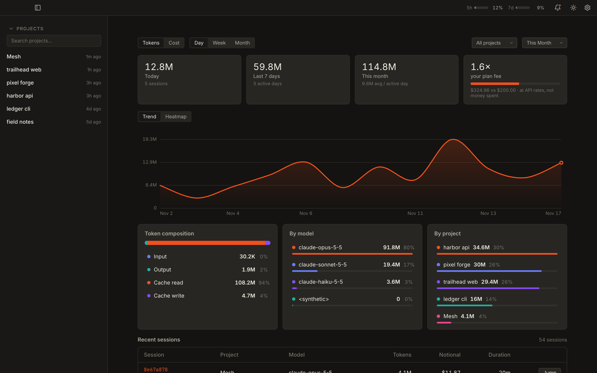
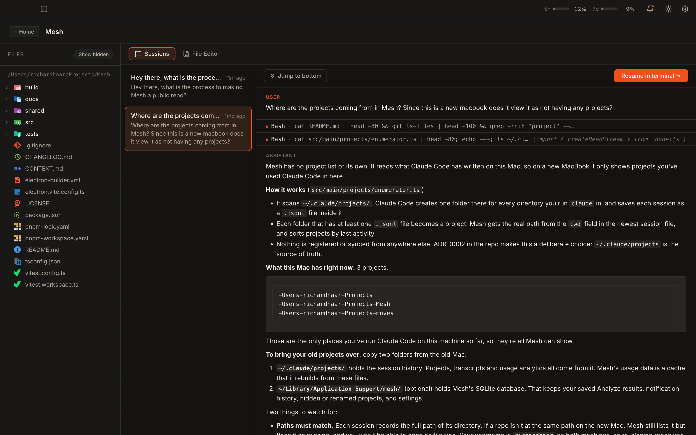
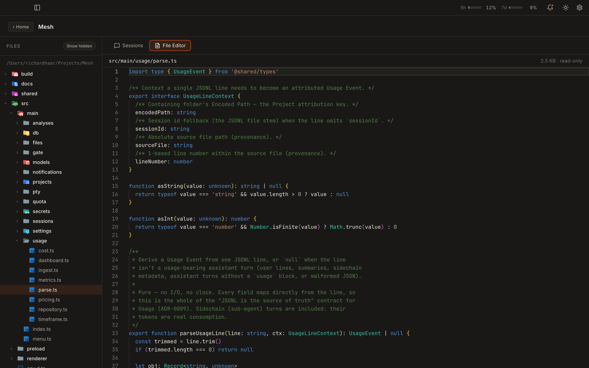
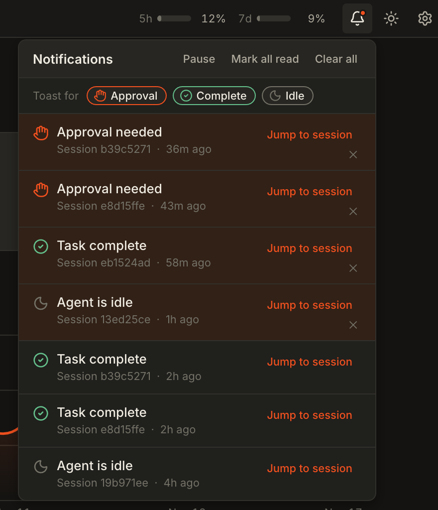
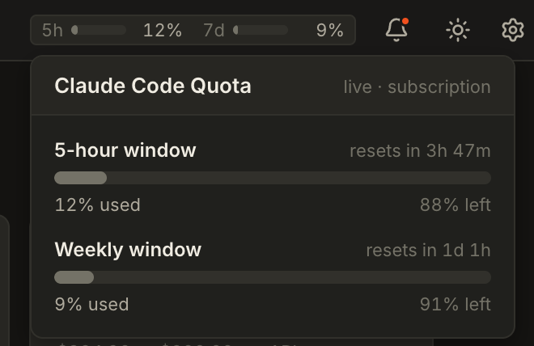
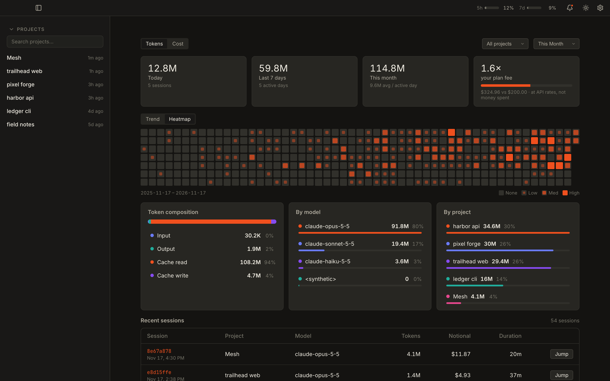

# Mesh

**An AI workspace OS for Claude Code.** Mesh is a macOS desktop app that turns the sessions Claude Code already writes to disk into one place to see your projects, pick up where you left off, and keep tabs on live agents.

  -lightgrey) 

<p align="center">
  
</p>

<p align="center"><sub>Screenshots use sample projects and usage data. The Mesh project, its transcript, and the Quota readings are real.</sub></p>

---

## Why Mesh

Claude Code keeps every conversation as a JSONL file under `~/.claude/projects/`. After a few weeks of real use, that's dozens of sessions across many projects, plus agents running in terminals you've moved away from. The CLI can't tell you:

- Which projects have been active, and what happened in them last week?
- Which agents are running right now, and which one is waiting on me?
- How much am I using Claude Code, and how close am I to my limits?

Mesh answers those questions without asking you to set anything up. It reads the data Claude Code already produces and adds its own layer on top.

## Features

### Projects and sessions

<p align="center">
  
  
</p>

- **Auto-discovery.** Every directory you've opened Claude Code in appears in the sidebar, sorted by last activity. There's nothing to register.
- **Transcripts.** Browse any past Session as a readable conversation. Tool calls appear as one-line summaries, and sub-agent conversations (Sidechains) appear inline. **Resume in terminal** picks the Session back up in one click.
- **Workspace.** Double-click a Project to open it. You get a gitignore-aware live file tree, the Project's Sessions, and read-only, syntax-highlighted file viewing (Monaco + Shiki).

### Live terminals

- **Resume** any Session in an embedded terminal (`claude --resume`) across multiple tabs.
- Terminals keep their scrollback and state when you switch screens. They close only when their process ends.

### Notifications

<p align="center">
  
</p>

Run several agents at once without watching every terminal. Mesh reads each live terminal's screen and tells you when an agent needs you.

- **Three signals.** *Approval needed* when an agent is waiting on a permission prompt, *Task complete* when it finishes, and *Agent is idle* when it has gone quiet. The idle signal catches anything the other two miss.
- **Jump to session** takes you straight to the agent's terminal so you can answer it.
- **Toasts you control.** Choose which signals pop up a toast with the **Toast for** filters, or mute a whole project. **Pause** silences all toasts until you resume. Approval toasts stay up until you answer.
- **Nothing gets lost.** Every notification is saved to the panel, including muted ones. Unread ones are highlighted until you read or clear them.

### Claude Code Quota

<p align="center">
  
</p>

Know where you stand before you start a long run.

- **Always visible.** The toolbar shows how much of your Claude subscription's **5-hour** and **weekly** windows you've used, on every screen.
- **Time to reset.** Open the gauge to see percent used, percent left, and a countdown to each window's reset.
- **Opt-in.** Quota is off by default. It's Mesh's only outbound call besides Analyze, and it reads Claude Code's existing sign-in. You don't enter anything new. See [ADR-0011](docs/adr/0011-networked-quota-exception.md).

### Usage analytics

<p align="center">
  
</p>

- **Token usage over time.** Switch between a trend chart (by day, week, or month) and a year-long **Activity Heatmap**.
- **Breakdowns** by token type (input, output, cache read and write), by model, and by project. A Recent sessions table lists each Session's model, tokens, cost, and duration, with a **Jump** link.
- **Filters.** Scope the dashboard to one project and to a timeframe: This Month, the last 7, 30, or 90 days, or all time.
- **Notional Cost:** usage priced at published API rates, to measure intensity. *It is not money spent.*
- **Metric cards** for Today, Last 7 days, This month, and **Subscription Utilization** (your notional usage as a multiple of your plan fee).

### Analysis

- Click **Analyze** on a Project to get a three-part LLM update: *Summary of Recent Sessions*, *Next Steps*, and *Suggested Improvements*.
- Works with Claude or OpenAI models. API keys are encrypted with a key held in the macOS Keychain (Electron `safeStorage`). Mesh won't store a key in plaintext.

### Worktree runs

- `no-mistakes` gate runs and other git worktrees nest under their Parent Project, with pass/fail status, branch, intent, and a PR link. Their usage counts toward the parent's totals.

## Requirements

| | |
|---|---|
| **macOS** | 12 Monterey or newer, Apple Silicon or Intel |
| **Claude Code CLI** | Required to Resume sessions (`claude` on your `PATH`). Everything else works without it. |
| **API key** | Anthropic or OpenAI, required only for Analyze |
| **Internet** | Only for Analyze and the optional Quota gauge. Everything else runs offline. |

## Install (beta)

Mesh is pre-1.0 and doesn't ship signed installers yet, so you build it from source.

**Build tools:** Node.js 20+ (tested on 24 LTS), pnpm, and Xcode Command Line Tools. The Command Line Tools compile the native modules (`better-sqlite3`, `node-pty`).

```bash
git clone git@github.com:itsrichardhaar/Mesh.git
cd Mesh
pnpm install
pnpm package
```

Then move the app into Applications:

```bash
mv dist/mac-arm64/Mesh.app /Applications/   # Apple Silicon
mv dist/mac/Mesh.app /Applications/         # Intel
```

**First launch:** if you downloaded the build instead of building it yourself, macOS Gatekeeper will block it. Right-click `Mesh.app`, choose **Open**, and confirm. You only need to do this once. Then open **Settings** (⌘,) and add an API key to enable Analyze.

To produce distributable disk images for both architectures, run `pnpm dist`. It builds `dist/Mesh-<version>.dmg` (Intel) and `dist/Mesh-<version>-arm64.dmg` (Apple Silicon).

See [docs/DEPLOYMENT.md](docs/DEPLOYMENT.md) for updating, backups, and uninstalling.

## Using Mesh

| Screen | How to get there | What it's for |
|---|---|---|
| **Home** | App launch | All Projects in the sidebar, and global Usage on the right |
| **Project** | Single-click a Project | Catch up after time away: its usage, Analyze, and the latest Analysis |
| **Workspace** | Double-click a Project | Deep work: file tree, Sessions list, transcripts, and live terminals |
| **Settings** | ⌘, | Providers and models, API keys, notifications, Quota, and your subscription plan |

| Shortcut | Action |
|---|---|
| ⌘, | Open Settings |
| ⌘[ | Back |
| ⌘. | Show or hide hidden files |
| ⌘W | Close Settings, or the window |

## Your data

| Location | What's there | Owner |
|---|---|---|
| `~/.claude/projects/` | Sessions: the source of truth for Projects | Claude Code |
| `~/Library/Application Support/Mesh/mesh.db` | Analyses, settings, notifications, usage cache, and encrypted API keys | Mesh |
| macOS Keychain | The encryption key that protects your API keys | Mesh |

**Mesh never writes to `~/.claude/`.** Mesh is local-first, with two ring-fenced exceptions. It makes one network call, the opt-in Quota fetch ([ADR-0011](docs/adr/0011-networked-quota-exception.md)). It also reads one other tool's data, `no-mistakes`' state file, read-only ([ADR-0014](docs/adr/0014-worktree-runs-nested-under-parent.md)). Analyze calls go only to the provider you've configured.

## Development

```bash
pnpm install     # installs deps and rebuilds native modules for Electron
pnpm dev         # run the app with hot reload
```

| Script | What it does |
|---|---|
| `pnpm dev` | Runs Mesh in development mode (electron-vite) |
| `pnpm test` | Runs the full test suite once (both vitest projects) |
| `pnpm test:watch` | Runs tests in watch mode |
| `pnpm typecheck` | Type-checks without emitting (`tsc --noEmit`) |
| `pnpm package` | Builds an unpacked `.app` for this Mac's architecture |
| `pnpm dist` | Builds `.dmg` installers for arm64 and x64 |

> **Native modules:** `better-sqlite3` and `node-pty` are compiled against *either* Node (for tests) *or* Electron (for the app). The scripts rebuild them automatically. `test` targets Node, and `dev`, `package`, and `dist` target Electron. You don't need to do it by hand. If a native build fails with a linker or SDK error, update your Command Line Tools first.

### Project structure

```
src/
  main/          Electron main process: filesystem, SQLite, PTYs, IPC
    projects/      Project discovery from ~/.claude/projects
    sessions/      JSONL session parsing and transcripts
    pty/           node-pty terminals and claude CLI resolution
    notifications/ Screen model, pattern matchers, idle detector
    analyses/      Analyze orchestration
    models/        Provider-agnostic ModelClient (Claude, OpenAI)
    usage/         Usage event cache and dashboard queries
    quota/         Opt-in live Quota fetch
    gate/          Read-only no-mistakes state reader
    db/            SQLite setup and versioned migrations
    secrets/       Keychain-backed API key storage
  preload/       Typed window.api bridge
  renderer/      React UI: screens, components, Zustand stores
shared/          Types and IPC contracts shared by main and renderer
tests/           main (node) and renderer (jsdom) vitest suites
docs/            PRDs, ADRs, deployment, and release docs
```

### Architecture at a glance

- **The filesystem is the source of truth.** Mesh derives Projects and Sessions from Claude Code's own files. SQLite only *adds* data (overrides, analyses, notifications, usage cache) and never duplicates it. See [ADR-0002](docs/adr/0002-claude-projects-is-source-of-truth.md).
- **Versioned migrations.** Every schema change is a numbered migration, and tests run the full upgrade chain from the first migration on every run.
- **Provider abstraction.** A single `ModelClient` interface puts Claude and OpenAI behind the same Zod-validated structured output. See [ADR-0003](docs/adr/0003-provider-abstraction-claude-only-v1.md) and [ADR-0005](docs/adr/0005-openai-as-second-functional-provider.md).
- **Terminal lifetime follows process lifetime.** An app-level portal host moves terminal views between screens without React remounting them. See [ADR-0008](docs/adr/0008-pty-view-lifetime-follows-pty-lifetime.md).
- **Notifications from screen structure.** A headless xterm buffer resolves the terminal screen, pure matchers classify it, and an idle timer catches anything they miss. See [ADR-0012](docs/adr/0012-pattern-matcher-notifications-idle-as-recall-floor.md).
- **Renderer as cache.** The UI writes through IPC and updates from echo events, so it never shows data that hasn't been saved. See [ADR-0007](docs/adr/0007-zustand-for-renderer-state.md).

**Stack:** Electron 33 · React 18 · TypeScript · Vite (electron-vite) · SQLite (better-sqlite3) · node-pty + xterm.js · Zustand · Zod · Monaco · Shiki · Vitest

## Documentation

| Doc | Purpose |
|---|---|
| [CONTEXT.md](CONTEXT.md) | Domain glossary: the vocabulary used across code, docs, and commits |
| [CHANGELOG.md](CHANGELOG.md) | Release history |
| [docs/adr/](docs/adr/) | 14 architecture decision records, each with the alternatives considered |
| [docs/PRD-v11.md](docs/PRD-v11.md) | The current release's product requirements (earlier PRDs are alongside it) |
| [docs/DEPLOYMENT.md](docs/DEPLOYMENT.md) | Install, update, backup, uninstall, and the 1.0 production checklist |
| [docs/RELEASES.md](docs/RELEASES.md) | Release channels and promotion rules |

## Status

Mesh is in **beta** (`0.x`), and breaking changes between releases are allowed. Version `1.0.0` ships once the Go-Public items in the [production checklist](docs/DEPLOYMENT.md#production-checklist) pass: code signing and notarization, auto-updates, and clean-machine verification.

## License

Proprietary. © 2026 Richard Haar. All rights reserved. See [LICENSE](LICENSE).
